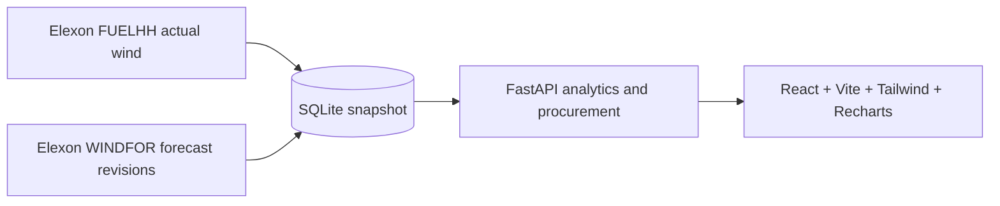

# WindDesk

WindDesk is a full-stack app for a UK energy utility trading team. It uses national wind forecasts and actuals from Elexon BMRS to show the decision-time forecast, evaluate its error, and calculate how much additional energy to procure after subtracting usable wind from the utility's own demand forecast.

## Problem and solution

Wind generation is uncertain. WindDesk recreates the decision-time view by selecting, for each delivery hour on D+1, the latest genuine forecast published on decision day D by the chosen cutoff. Forecast revisions later than the cutoff remain visible in the evolution chart but are not used in that decision snapshot or its accuracy metrics.

The committed `backend/data/app.db` is marked `elexon` and retains 1,584 half-hour actual rows and 18,104 hourly forecast revisions. Forecast, Accuracy, Buy plan, and Backtest API routes read the local SQLite snapshot; they do not call Elexon at request time.

## Architecture



Elexon data is stored in SQLite and analyzed by the API. No upstream request is made while serving a page or API request.

## Folder structure

```text
.
|-- docker-compose.yml
|-- README.md
|-- backend/
|   |-- .dockerignore
|   |-- .env.example
|   |-- Dockerfile
|   |-- requirements.txt
|   |-- app/
|   |   |-- main.py
|   |   |-- api/routes/{health,analytics,procurement}.py
|   |   |-- config/settings.py
|   |   |-- data_access/database.py
|   |   |-- schemas/responses.py
|   |   `-- services/{analytics,procurement}.py
|   |-- scripts/ingest.py                # Resume-safe Elexon snapshot ingestion
|   |-- data/app.db
|   `-- tests/{test_analytics,test_api,test_database,test_procurement}.py
`-- frontend/
    |-- .env.example
    |-- index.html
    |-- package.json
    |-- vite.config.js
    `-- src/
        |-- api.js, App.jsx, main.jsx, style.css
        |-- layout/{Sidebar,TopBar}.jsx
        |-- pages/{Dashboard,LegacyPages}.jsx
        `-- ui/{Card,CsvButton,Icon,KpiCard,Skeleton,Tabs}.jsx
```

## Frontend structure and UI

The frontend uses a responsive, hash-navigable shell. Its default page is the Dashboard; the sidebar links to Dashboard, Buy plan, Forecast, and Accuracy. The decision date and UTC cutoff are shared in the sticky top bar, with Accuracy-specific range controls shown on that page. The cutoff reminder is dismissible and keeps the unverified gate-closure assumption visible without taking a large banner area.

- `frontend/src/layout/Sidebar.jsx` and `TopBar.jsx`: desktop collapse, mobile drawer, hash navigation, shared controls, source/version context.
- `frontend/src/pages/Dashboard.jsx`: independently loaded KPI and chart widgets, data coverage derived from the accuracy series, and keyboard-accessible dashboard detail tabs.
- `frontend/src/pages/LegacyPages.jsx`: existing Buy plan, Forecast, and Accuracy views, retained with their inputs, warnings, calculations, API contracts, and CSV contents.
- `frontend/src/ui/`: shared cards, KPI cards, icon set, skeletons, tabs, and CSV status button.
- `frontend/src/style.css`: the light-only visual system and solid CSS color tokens; `frontend/src/api.js` provides a short-lived GET cache and abortable 30-second requests.

KPI values count up with `requestAnimationFrame`; Recharts marks animate when their data changes. Cards and pages use short CSS transitions. `prefers-reduced-motion` disables or shortens CSS and chart motion, and the KPI hook respects the same system preference. Dashboard detail tabs only mount the selected panel. CSV buttons preserve the existing export data and show Preparing, Downloaded, then idle states.

Dashboard widgets use only existing APIs: forecast-versus-actual uses `/api/v1/forecast`; MAE, bias, RMSE, MAPE, monthly overlay, and complete-date coverage use `/api/v1/accuracy`; lead-time errors use `/api/v1/accuracy/by-horizon`; hourly bias uses `/api/v1/accuracy/by-hour-of-day`; the histogram uses `/api/v1/accuracy/error-distribution`; and the backtest card uses `/api/v1/procurement/backtest` with a labelled 30,000 MW placeholder demand. Coverage is computed client-side as the number of decision dates with all 24 forecast/actual pairs in the returned monthly series. No demand or market observations are fabricated.

## Data source and resolution

The only production data source is the public Elexon BMRS Insights API:

- Actual generation: `GET https://data.elexon.co.uk/bmrs/api/v1/datasets/FUELHH/stream`, queried with `settlementDateFrom`, `settlementDateTo`, and `fuelType=WIND`. FUELHH actuals are half-hourly, with generation expressed as average MW over each 30-minute period.
- Forecast revisions: `GET https://data.elexon.co.uk/bmrs/api/v1/datasets/WINDFOR/stream`, queried with `publishDateTimeFrom` and `publishDateTimeTo` in UTC. The loaded WINDFOR records are hourly, with `startTime` on the hour.

FUELHH actuals are stored half-hourly and grouped by hour in memory. WindDesk uses the mean of the `:00` and `:30` values as the actual for the hour beginning at `:00`. An hourly actual is available only when both half-hours exist; an incomplete pair makes that hour missing. Hourly forecasts and hourly actuals are joined on the hourly `startTime`. All timestamps are normalized to ISO-8601 UTC strings ending in `Z`.

The original Elexon forecast snapshot had about 73 hourly target rows per publication batch. The current SQLite snapshot contains 18,104 forecast revision rows. Rows whose `startTime` precedes `publishTime` are hindsight values repeated in the batch; they are excluded from selection, evolution, and horizon analysis.

For a decision date D, the backend reads actuals for delivery date D+1 from SQLite. It reads stored forecast revisions for that delivery date and the existing selection logic chooses the latest publish time no later than the selected cutoff. Evolution includes the delivery day's stored revisions, including after-cutoff batches, while excluding hindsight rows.

Publish times observed in the Jan 1, 2026 data were 02:30, 04:30, 07:30, 09:30, 11:30, 15:30, 18:30, and 22:30 UTC. This is an observation from the data, not an official or guaranteed publishing schedule. For the Jan 1 decision, a 10:00 cutoff selects the 09:30 batch; a 09:00 cutoff selects the 07:30 batch.

## Decision-time rule and assumptions

- Decision dates are 2026-01-01 through 2026-01-31. Each covers delivery on D+1, 2026-01-02 through 2026-02-01.
- The default cutoff is 10:00 UTC on decision day. **This is an assumption; the actual day-ahead gate closure time was not verified.** It can be configured with `DEFAULT_CUTOFF_UTC` and overridden through the API or UI.
- For each delivery hour, selection uses the latest `publishTime` no later than the cutoff. Forecasts after the cutoff and hindsight rows (`startTime < publishTime`) are never selected.
- `/api/v1/meta` lists the 31 queryable decision dates and reports the local snapshot row counts.
- Missing forecast or actual hours are shown as missing, excluded from error metrics, and counted in `n_missing`.

## Metrics

- **MAE**: mean absolute forecast error, in MW.
- **RMSE**: square root of mean squared forecast error, in MW.
- **Bias**: mean of forecast minus actual, in MW. Positive means over-forecast wind.
- **MAPE**: mean absolute percentage error. Actuals below 1 MW, including zero, are excluded.
- **n_points** counts hourly values with both a selected forecast and actual. **n_missing** counts expected hours with either absent.
- Error percentiles use signed forecast-minus-actual errors. The buying guidance uses P95 of absolute hourly error as a historical reference, not a prescribed reserve amount.
- Horizon analysis uses all genuine revisions with nonnegative lead time, in bins 0-6h, 6-12h, 12-24h, 24-48h, 48-72h, and 72h+.

## Buy plan methodology

- Demand is a user input from the utility, entered as one flat MW value or 24 hourly values. Elexon does not provide this demand, and the UI's 30,000 MW default is a clearly labelled placeholder, never an observation.
- For each delivery hour, required purchase is `max(0, demand - usable_wind)`. Naive usable wind is the selected cutoff forecast. Bias-adjusted usable wind is `forecast - mean(error)`. Recommended risk-adjusted usable wind is `max(0, forecast - q_confidence(error))`. Error is `forecast - actual`; positive error means the forecast overestimated wind and therefore understates the purchase needed.
- Calibration for decision date D uses only prior decision dates through D-2 (their delivery actuals are complete by D), evaluated at the same cutoff. At least three complete prior delivery days are required; otherwise calibrated strategies fall back to the naive plan and the API/UI warn that history is insufficient. The opt-in full-month option is in-sample demonstration only and leaks future information by design.
- Errors are pooled across all delivery hours because one month provides too few observations per hour-of-day. Confidence choices are 50%, 80%, 90%, and 95%; the signed empirical error quantile is applied as a conservative wind deduction.
- Backtest walks through decision dates, calibrating each only from its eligible D-2 history and skipping days without enough history. Coverage is the share of evaluated delivery hours where recommended buying was at least the hindsight need; the target is the selected confidence. Shortfall and surplus are compared to `max(0, demand - actual_wind)`.
- Backtest totals depend on the supplied flat demand assumption. With flat demand, coverage itself depends only on wind forecast errors. Results use a single month of observations, pool errors across hours, and model no cost asymmetry between shortages and surplus. The placeholder demand must be replaced with the utility's own demand forecast.

## API

Swagger UI is at `http://localhost:8000/docs`, ReDoc at `/redoc`, and OpenAPI JSON at `/openapi.json`.

| Method and path | Purpose |
|---|---|
| `GET /health` | API/database status and row counts |
| `GET /api/v1/meta` | All decision dates with hourly coverage, cutoff, assumptions, and source |
| `GET /api/v1/forecast?decision_date=2026-01-08&cutoff=10:00` | 24 selected hourly forecasts and summary; returns `data_available=false` with a message if unavailable |
| `GET /api/v1/forecast/evolution?decision_date=2026-01-08&cutoff=10:00` | Genuine hourly revision batches, including after-cutoff status |
| `GET /api/v1/accuracy?from=2026-01-01&to=2026-01-31&cutoff=10:00` | Decision-time metrics and hourly series |
| `GET /api/v1/accuracy/error-distribution?from=2026-01-01&to=2026-01-31&cutoff=10:00` | Error histogram and percentiles |
| `GET /api/v1/accuracy/by-horizon?from=2026-01-01&to=2026-01-31` | Error by genuine forecast lead-time bin |
| `GET /api/v1/accuracy/by-hour-of-day?from=2026-01-01&to=2026-01-31&cutoff=10:00` | Error by UTC delivery hour |
| `POST /api/v1/procurement/plan` | Hourly purchase plan from cutoff forecast, user demand, and eligible historical forecast errors |
| `GET /api/v1/procurement/backtest?from=2026-01-01&to=2026-01-30&cutoff=10:00&confidence=0.9&demand_mw=30000` | D-2 walk-forward coverage, shortfall, and surplus by strategy |

Dates outside January 2026, invalid ranges, and malformed cutoffs return 4xx errors. An in-memory rate limit allows 120 requests per minute per client IP.

## Run locally

### Backend

```sh
docker compose build backend
docker compose up -d backend
curl http://localhost:8000/health
```

The Compose service mounts `backend/data` at `/app/data` for SQLite persistence and mounts backend app code for development reload. Stop it with `docker compose down`.

### Frontend

```sh
cd frontend
cp .env.example .env
npm install
npm run dev
```

Vite serves the UI at `http://localhost:5173`. The default API URL is `http://localhost:8000`.

### Tests

```sh
docker compose run --rm backend pytest -q
```

The suite covers hourly aggregation, cutoff selection, hindsight exclusion, plan calibration/no-look-ahead, plan math, validation, API contracts, and startup schema initialization preserving existing data.

### Restore or refresh the local data snapshot

The API and ingestion script use the same `DATABASE_PATH` (`/app/data/app.db` in Compose), backed by `backend/data/app.db` on the host. Ingestion is idempotent and does not delete existing rows by default:

```sh
docker compose run --rm backend python -m scripts.ingest --database /app/data/app.db --start 2026-01-01 --end 2026-02-02
```

Only pass `--replace` when you intend to clear the selected existing dataset tables; the script logs the deletion counts before doing so. Startup never removes data.

## Environment variables

### Backend (`backend/.env.example`)

| Variable | Default | Purpose |
|---|---|---|
| `DATABASE_PATH` | `/app/data/app.db` | SQLite path |
| `CORS_ORIGINS` | `http://localhost:5173` | Allowed origins, comma-separated |
| `DEFAULT_CUTOFF_UTC` | `10:00` | Assumed decision cutoff |
| `APP_VERSION` | `1.0.0` | API version |
| `LOG_LEVEL` | `INFO` | Structured log level |

### Frontend (`frontend/.env.example`)

| Variable | Default | Purpose |
|---|---|---|
| `VITE_API_BASE_URL` | `http://localhost:8000` | FastAPI origin |

## SQLite data

`backend/data/app.db` currently contains 1,584 actual half-hours and 18,104 forecast revisions. The runtime analytics routes read this local snapshot and make no Elexon calls. `DATABASE_PATH` defaults to `/app/data/app.db`.

## Deployment preparation

Nothing has been deployed. The committed database contains Elexon observations.

### Vercel frontend

- Root directory: `frontend`
- Build command: `npm run build`
- Output directory: `dist`
- Set `VITE_API_BASE_URL` to the deployed backend URL.

### Render backend

- Create a Docker web service with root directory `backend` and use `backend/Dockerfile`.
- Set `DATABASE_PATH=/app/data/app.db`, `DEFAULT_CUTOFF_UTC=10:00`, and `CORS_ORIGINS` to the Vercel origin.
- The free tier sleeps while idle, so its first request can be slow.

**Live app links:** Vercel: _not deployed_ | API: _not deployed_

## Known limitations

- The checked-in SQLite snapshot contains one historical month of actuals and forecasts; it does not update automatically with new Elexon releases.
- 10:00 UTC is a configurable cutoff assumption; the real market gate closure time was not verified.
- The observed publish times are not an official schedule.
- SQLite targets this fixed historical dataset and single-service deployment, not multi-writer workloads.

## AI-assisted development

OpenAI Codex and Claude were used to assist development. Human review remains necessary before operational trading use.
